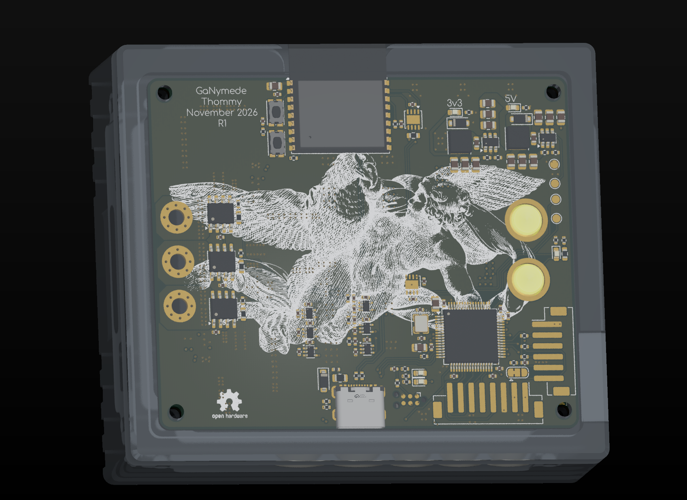
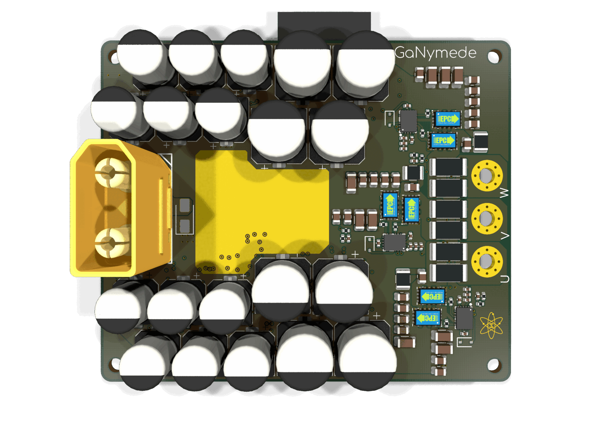

# GaNymede

**Open 60 V, 100 A peak three-phase GaN motor controller, VESC compatible.**

<table><tr>
<td></td>
<td></td>
</tr></table>

---

## Overview

GaNymede is an open-source, 60 V three-phase motor controller built around six EPC2361 eGaN FETs and three LMG1210 half-bridge drivers. It is sized for a direct-drive hub motor: **50 A phase current continuously, 100 A phase peak for one minute**, with phase-current and phase-voltage sensing on every leg, Hall inputs, and an ESP32-C3 for wireless telemetry.

The board is a compact 78 × 65 mm six-layer design, with the bus capacitor bank wrapped around the power stage and the copper pours sized around the full 100 A phase peak. The control side follows the familiar VESC pattern — STM32F405, three Hall inputs, three phase-current channels.

This repository is the hardware design; it does not include firmware.

LLMs were used in the design of this driver, specifically Deepseek-V4.1-Flash(1017) was used to do schematic reviews, loss analysis, component finding.

---

## Specifications

| Parameter | Value |
|---|---|
| Bus voltage | up to 60 V DC |
| Phase current | 50 A continuous · 100 A peak (1 min) |
| Peak output power | ≈ 5.2 kW at 100 A phase peak (m = 1, modelled) |
| Topology | 3-phase inverter, 6× EPC2361 100 V eGaN |
| Switching frequency | 20 kHz nominal design point (10–40 kHz analysed) |
| Gate drive | LMG1210, 5 V, 2.2 Ω |
| Current sense | 0.25 mΩ per phase, INA240A1 |
| Control | STM32F405RGT6, 168 MHz, 8 MHz HSE |
| Wireless | ESP32-C3-WROOM-02 (Wi-Fi / BLE) |
| CAN | 2× TJA1051TK-3 (STM32 + ESP32), shared bus |
| Input | XT90 |
| Phase outputs | 3× 3 mm plated through-holes (U / V / W) |
| PCB | 78 × 65 mm, 6-layer, 1.6 mm, 1 oz Cu |

Phase currents are amplitudes, not RMS: 100 A peak is 70.7 A RMS.

---

## Hardware

| Component | Part |
|---|---|
| MCU | STM32F405RGT6 (LQFP-64) |
| Wireless | ESP32-C3-WROOM-02 |
| Power stage FETs | 6× EPC2361 (100 V eGaN) |
| Gate drivers | 3× LMG1210 |
| Current sense | 3× INA240A1, 0.25 mΩ per phase |
| Input connector | XT90 |
| Phase outputs | 3× 3 mm plated through-holes |

### Power stage

- Six EPC2361 100 V eGaN FETs, two per phase, switching a 60 V bus. The 100 V rating leaves headroom for turn-off overshoot; the real margin depends on power-loop inductance and is worth a double-pulse check.
- Each phase uses an LMG1210 driven from 5 V with 2.2 Ω gate resistors. DHL and DLH are strapped high, selecting independent high/low inputs — **dead time is set in firmware**, not by the driver.
- Bootstrap diodes are BAT46WS; each phase carries a 2.2 nF + 1 Ω snubber.
- Phase current is measured across 2× 0.5 mΩ 2512 resistors in parallel (0.25 mΩ per phase) into an INA240A1 at a gain of 20.
- The bus capacitor bank is roughly 1.4 mF (8× 100 µF 80 V, 12× 47 µF 100 V, plus ceramics), protected by an SMAJ60A TVS.
- Phase outputs land on three 3 mm plated through-holes labelled U, V and W.

---

## Thermal & loss budget

[`LOSSES.md`](LOSSES.md) contains the full copper, semiconductor and thermal model. These are **modelled** numbers, not measurements:

| | 100 A peak (1 min) | 50 A continuous |
|---|---|---|
| Total loss | ≈ 29 W | ≈ 7.3 W |
| Efficiency | ≈ 99.4 % | ≈ 99.7 % |
| Junction temperature | 45 → 62 °C | 43 °C |

Assumptions: 60 V bus, 20 kHz switching, 0.25 mΩ shunts, 0.4 mm / 6 W/mK thermal pads, 30 °C ambient — the addendum case in `LOSSES.md`.

- The **phase shunts and the 60 V / GND copper** dominate the loss budget, not the six GaNs.
- The heatsink needs to handle roughly 5–6 W continuous and up to ~20 W by the end of a 100 A minute. A 1.5–2 °C/W natural-convection sink is enough, or bolt the plate to the frame.
- The thermal pad matters more than the heatsink: a flat, thin, high-conductivity pad is worth tens of degrees at 100 A.
- The one-minute 100 A rating is limited by thermal mass, not by the heatsink.

---

## Acknowledgements / Based On

- [**VESC / bldc**](https://github.com/vedderb/bldc) — the open BLDC controller ecosystem and the control-side conventions this board follows.
- [**nitride-nano**](https://github.com/NovaPrime18/nitride-nano) — README layout, and the copper-loss analysis method reused in `LOSSES.md`.

---

## License

Hardware design files are licensed under the **CERN Open Hardware Licence Version 2 – Strongly Reciprocal (CERN-OHL-S v2.0)**.

See [`LICENSE`](./LICENSE) for the full text, or visit [ohwr.org/cern_ohl_s_v2](https://ohwr.org/cern_ohl_s_v2.txt).

> In short: you are free to use, study, modify, and distribute this design, provided that any derivatives are released under the same licence and source files are made available.

---

## Status

> 🚧 Work in progress — schematic and 6-layer layout are drawn; The current and thermal figures above are design targets from the loss model, not measured ratings.
